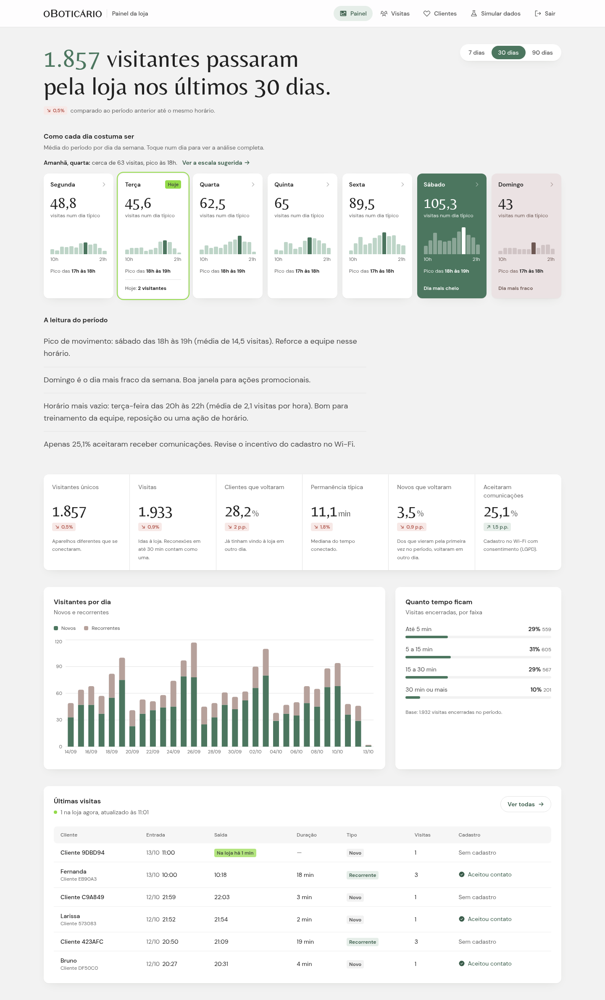

# Painel de Wi-Fi de Visitantes

Painel para o dono de uma loja O Boticário entender o fluxo de clientes a partir dos acessos ao Wi-Fi de visitantes. Desafio técnico para a vaga de desenvolvedor full-stack (Grupo Boticário), feito em 2 dias.



## Índice

- [Para avaliar em 5 minutos](#para-avaliar-em-5-minutos)
- [O problema](#o-problema)
- [O que o painel faz](#o-que-o-painel-faz)
- [Arquitetura](#arquitetura)
- [Como rodar](#como-rodar)
- [Testes](#testes)
- [Uso de IA](#uso-de-ia)
- [Documentação](#documentação)

## Para avaliar em 5 minutos

### Acesso

O deploy **ainda não foi feito**; o passo a passo está em [`docs/deploy.md`](docs/deploy.md). Rodando localmente ([Como rodar](#como-rodar)):

| O quê | URL |
|---|---|
| Painel (web) | http://localhost:3000 |
| API | http://localhost:3001 |
| Swagger | http://localhost:3001/docs |
| Login de demonstração | `dono@loja.demo` / `demo1234` |

### Roteiro

1. **Painel:** entre com o login de demonstração. A manchete diz como foram os últimos 30 dias e a semana típica mostra quando a loja enche: o dia mais cheio em verde, o mais fraco em rosado e hoje contornado. Troque o período para 7 ou 90 dias.
2. **Um dia da semana:** toque no sábado. Aparecem o movimento hora a hora contra a média dos outros dias, a faixa em que vale reforçar a equipe e a escala sugerida, com quantas pessoas por horário.
3. **Simular dados:** escolha "Loja lotada" e clique em Gerar. São 120 visitas nas últimas 2 h, gravadas pela mesma ingestão que o portal do Wi-Fi usaria.
4. **Visitas:** veja quem está na loja agora, o aviso de loja cheia e cada visita com entrada, saída e duração. Abra um cliente para ver a ficha: segmento, frequência e histórico, identificado só por apelido (LGPD).
5. **Clientes:** a retenção por turma mostra quantos clientes novos voltaram em 7, 30 e 60 dias, e a lista de reativação exporta em CSV quem sumiu e aceitou contato.

## O problema

O dono quer visibilidade sobre o Wi-Fi de visitantes para decidir melhor. A leitura que adotei: **o Wi-Fi é um sensor de fluxo da loja**, porque cada aparelho que conecta é um cliente presente. Por isso o painel responde perguntas de negócio em vez de listar conexões:

| Pergunta do dono | Onde o painel responde |
|---|---|
| Como foi o período e quando a loja enche? | Manchete do período e semana típica, com o pico de cada dia |
| Hoje está bom? | Hoje contra o típico desse dia **até o mesmo horário** |
| Quantas pessoas escalar? | Escala sugerida por faixa de horário e a projeção de amanhã |
| Quem está na loja agora? | Visitas ao vivo, com aviso de loja cheia |
| O cliente volta? | Recorrência, novos que voltaram e retenção por turma |
| Quem vale chamar de volta? | Clientes sumidos que aceitaram contato, com exportação em CSV |

Todas as perguntas, as decisões que cada métrica habilita e a definição exata de cada número: [`docs/metricas.md`](docs/metricas.md).

## O que o painel faz

- **Painel:** manchete do período (7, 30 ou 90 dias), semana típica, hoje contra o típico, amanhã, indicadores, insights em texto com a ação sugerida e últimas visitas.
- **Análise do dia** (ao tocar num dia da semana): movimento por hora, faixa de reforço, horário vazio e escala sugerida.
- **Visitas:** cada visita com entrada, saída e duração, filtros, busca, ficha do cliente e atualização a cada 30 s.
- **Clientes:** retenção por turma em 7, 30 e 60 dias e lista de reativação com CSV.
- **Simular dados:** gera movimento, testa a regra de visita e cadastra uma conexão à mão, tudo pela ingestão real.
- **Privacidade (LGPD):** MAC guardado só como HMAC, cliente por apelido na tela e e-mail só no CSV de quem aceitou contato.

**Design:** identidade O Boticário, a partir do site e do brand guidelines da marca (verde `#4C765F`, DM Sans no texto, Belleza nos títulos e foto do login de Bart Zimny, Unsplash License). A estrutura do painel foi escolhida entre composições comparadas lado a lado. Detalhes em [`docs/DESIGN.md`](docs/DESIGN.md) e [`docs/PRODUCT.md`](docs/PRODUCT.md).

## Arquitetura

Monorepo pnpm em TypeScript:

- **`packages/shared`:** regras de negócio comuns e schemas Zod do contrato, usados pelos dois lados.
- **`apps/api`:** NestJS + Prisma + Postgres. Toda regra de negócio e todo acesso a dados.
- **`apps/web`:** Next.js (App Router) só como front; não fala com o banco.

Diagrama, endpoints, modelagem de dados e tratamento de erros: [`docs/arquitetura.md`](docs/arquitetura.md).

## Como rodar

Requisitos: Node >= 22.12, pnpm 12 e Docker.

```bash
cp apps/api/.env.example apps/api/.env
cp apps/web/.env.example apps/web/.env.local
pnpm install
pnpm dev   # Postgres + migrations + dados de demonstração, API (3001) e web (3000)
```

Sem Docker, recomeçar do zero e o preenchimento automático da demo: [`docs/desenvolvimento.md`](docs/desenvolvimento.md).

## Testes

```bash
pnpm --filter @wifi/shared build   # contrato compartilhado (o pnpm dev já faz isso)
pnpm format:check && pnpm lint && pnpm typecheck
pnpm test        # 68 testes unitários da API e 3 checagens do front
pnpm test:e2e    # 34 testes e2e da API contra um Postgres real (o banco do docker compose precisa estar de pé)
pnpm build
```

O CI no GitHub Actions roda tudo isso a cada push. O que cada suíte cobre está em [`docs/desenvolvimento.md`](docs/desenvolvimento.md#testes).

## Uso de IA

Conduzi o projeto e usei a IA (Claude Code) como ferramenta de execução:

- **O que foi meu:** a leitura do problema, a stack, o escopo, as decisões de produto e de design e a revisão de cada entrega.
- **O processo que defini:** spec e plano aprovados antes do código; para cada tarefa, um agente implementa com os testes escritos antes e outro, independente, revisa contra a spec.
- **O que a IA fez:** executou o plano. Escreveu o código e os testes, e rodou as verificações (testes, lint, tipos, build, cliques no build de produção).
- **O que a revisão e as verificações pegaram** antes de chegar aqui: um guard de testes que apagava o banco de desenvolvimento, uma rota de simulação sem login, filtros que não navegavam em produção e um erro de fuso numa consulta SQL.
- **O que eu decidi tirar** depois de ver pronto: o cadastro de campanhas, cuja medição enganava.

Detalhes, decisões e erros da IA: [`docs/uso-de-ia.md`](docs/uso-de-ia.md).

## Documentação

| Documento | Conteúdo |
|---|---|
| [`docs/metricas.md`](docs/metricas.md) | O problema, as perguntas do dono e a definição de cada métrica |
| [`docs/arquitetura.md`](docs/arquitetura.md) | Diagrama, pacotes, endpoints, modelagem de dados e tratamento de erros |
| [`docs/desenvolvimento.md`](docs/desenvolvimento.md) | Como rodar localmente e o que cada teste cobre |
| [`docs/decisoes.md`](docs/decisoes.md) | Atalhos deliberados e seus limites, próximos passos e a recomendação para campanhas |
| [`docs/deploy.md`](docs/deploy.md) | Como publicar banco, API e web |
| [`docs/PRODUCT.md`](docs/PRODUCT.md) | O produto, para quem é, princípios e compromissos com a marca |
| [`docs/DESIGN.md`](docs/DESIGN.md) | O design system do painel: cores, tipografia e componentes |
| [`docs/padroes-de-codigo.md`](docs/padroes-de-codigo.md) | Regras de código do projeto, verificadas por Prettier e ESLint no CI |
| [`docs/uso-de-ia.md`](docs/uso-de-ia.md) | Como usei a IA, minhas decisões e onde ela errou |
| [`docs/ai-log.md`](docs/ai-log.md) | Diário factual, tarefa a tarefa |
| [`docs/planejamento/`](docs/planejamento/) | Especificação e plano de implementação, aprovados antes do código |
