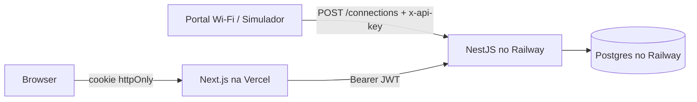

# Arquitetura

Como o sistema se divide, a API, o banco e o tratamento de erros. Voltar ao [README](../README.md).

## Visão geral

Onde cada parte vai rodar depois do deploy ([`deploy.md`](deploy.md)); localmente, tudo roda na sua máquina.

Monorepo pnpm:

| Pacote | Papel |
|---|---|
| `packages/shared` (`@wifi/shared`) | Regras de negócio comuns (`constants.ts`: 30 min de reconexão, 4 h na loja, segmentos…), schemas Zod e tipos do contrato (conexão, login, filtros, resposta de métricas). Usado pela API e pelo front: a validação é a mesma nos dois lados. |
| `apps/api` (`@wifi/api`) | NestJS + Prisma + Postgres. Módulos `connections` (ingestão), `metrics`, `visits`, `auth`, `simulation`, `health`. As métricas são funções puras em TypeScript sobre as visitas do período, testáveis sem banco. |
| `apps/web` (`@wifi/web`) | Next.js (App Router) **apenas como front**. Server Components buscam os dados no servidor; server actions fazem login e escrita. |

Endpoints da API:

| Método | Rota | Proteção | Função |
|---|---|---|---|
| POST | `/connections` | `x-api-key` | Cadastro de conexão (simula o portal do Wi-Fi) |
| POST | `/auth/login` | limite de 10/min por e-mail | Login do dono, JWT de 8 h |
| GET | `/metrics?range=7d\|30d\|90d` | JWT | Métricas do painel |
| GET | `/metrics/weekday?range=…&weekday=0..6` | JWT | Análise de um dia da semana no período |
| GET | `/visits?range=today\|7d\|30d&status=…&kind=…&lead=…&q=…&page=…` | JWT | Visitas, uma por linha, com cliente pseudonimizado e números ao vivo |
| GET | `/customers/retention` | JWT | Retenção por turma semanal (12 semanas) |
| GET | `/customers/lapsed?page=…` | JWT | Sumidos que aceitaram contato (apelido e primeiro nome) |
| GET | `/customers/lapsed.csv` | JWT | Mesma lista em CSV, com e-mail, para campanha de reativação |
| GET | `/customers/:id` | JWT | Ficha do cliente: segmento, frequência e histórico (404 se for de outra loja) |
| POST | `/simulate` | JWT | Gera N visitas nas últimas 2 h |
| POST | `/simulate/connection` | JWT | Cadastro manual de uma conexão (painel `/simular`) |
| GET | `/health` | nenhuma | Saúde da API e do banco |
| GET | `/docs` | nenhuma | Swagger |

**Por que o Next não fala com o banco.** O CSV de reativação, por exemplo, é baixado por uma rota do próprio Next (`/clientes/exportar`), que chama a API com o token do cookie; o token nunca chega ao navegador. De modo geral, Toda leitura e escrita passa pela API Nest: um único lugar com regras de negócio, validação e autorização, e o front pode ser trocado sem tocar nos dados. Os segredos ficam só no servidor: o JWT vai em cookie `httpOnly` (`painel_sessao`) e a `INGEST_API_KEY` só existe na API e no portal Wi-Fi (simulado); o Next não a conhece. A escrita pelo painel usa o JWT do dono (`/simulate/connection`). Nada disso chega ao JavaScript do navegador.

## Modelagem de dados

Cinco tabelas (`apps/api/prisma/schema.prisma`):

| Tabela | Conteúdo |
|---|---|
| `Store` | Loja e seu fuso (`America/Sao_Paulo`). |
| `Device` | Aparelho: `macHash` único por loja, primeira e última vez visto. |
| `Visit` | Uma ida à loja: início, fim opcional. |
| `Lead` | Cadastro opcional no portal (1 por aparelho): nome, e-mail, `marketingOptIn`, `consentAt`. |
| `User` | O dono, vinculado à loja. |

Decisões:

- **HMAC do MAC (LGPD).** O MAC é um identificador pessoal. Guardamos `HMAC-SHA256(MAC_HASH_SECRET, mac normalizado)`. Um hash simples seria reversível por força bruta (o espaço de MACs é pequeno); com o segredo no servidor, o vazamento do banco não revela os aparelhos. Isso ainda permite reconhecer o mesmo aparelho entre visitas.
- **Índice `(storeId, startedAt)` em `Visit`.** Toda consulta do painel é "visitas da loja no período"; o índice a cobre. O índice `(deviceId, startedAt)` atende a busca da visita anterior do aparelho na ingestão.
- **`Lead.consentAt`.** O consentimento é uma prova: registramos quando foi dado. O horário é preservado em reenvios do mesmo evento e só muda quando o `marketingOptIn` muda.
- **`@@unique([storeId, macHash])`** em `Device` garante um registro por aparelho mesmo com requisições concorrentes (a criação usa `upsert`).

## Erros e falhas

**API**
- Validação Zod com mensagens por campo (400).
- Filtro global com formato único: `{statusCode, message, details?, path, timestamp}`.
- 401 para chave de ingestão ou token inválidos; 404/409 para erros conhecidos do Prisma; 500 genérico com log (sem vazar detalhes).
- Variáveis de ambiente validadas na inicialização (falha rápida com mensagem clara).
- `/health` checa também o banco.
- Login: limite de 10 tentativas por minuto por e-mail (429) e comparação com hash fictício para não revelar se o e-mail existe.
- Chave de ingestão comparada com `timingSafeEqual`.

**Front**
- Esqueleto durante o carregamento (`<Suspense key>`, sem `loading.tsx`; ver a armadilha abaixo) e `error.tsx` (mensagem + tentar de novo).
- Estado vazio com caminho para gerar dados.
- Sessão expirada (401 da API) volta ao login com aviso.
- Timeout de 10 s nas chamadas à API.
- Erros de formulário por campo, reaproveitando os schemas Zod do pacote compartilhado.

## Uma armadilha do Next encontrada no caminho

Com um `loading.tsx` no grupo de rotas do painel, o Next 15.5 **em produção** buscava os dados novos mas não trocava a tela quando só os parâmetros da URL mudavam (ex.: o filtro de 7, 30 ou 90 dias). Em desenvolvimento funcionava, por isso passou despercebido na primeira versão. As páginas agora envolvem os dados em `<Suspense key={filtros}>`, com esqueletos em `components/ui/skeletons.tsx`: o filtro navega, o esqueleto aparece durante a troca e um endereço inválido responde 404 de verdade.
